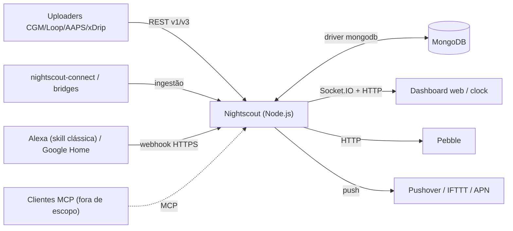
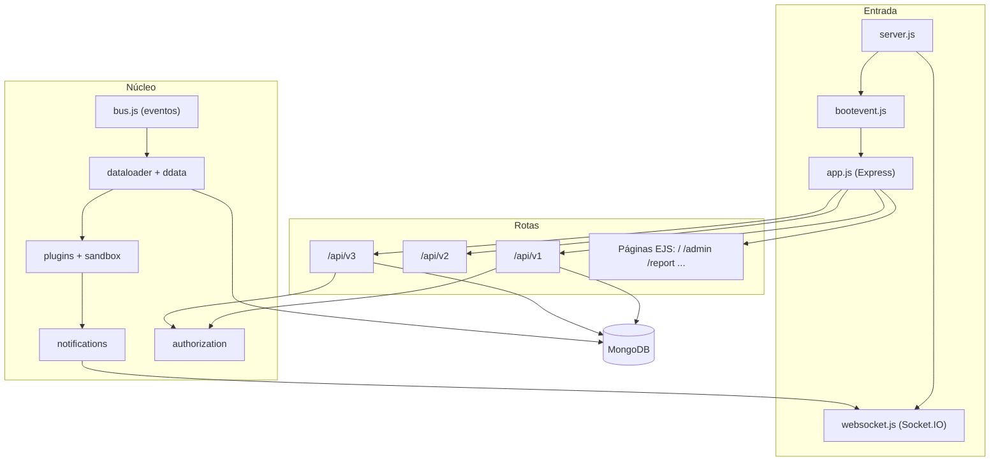
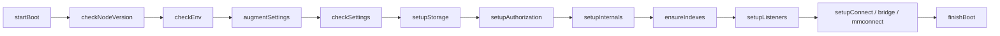
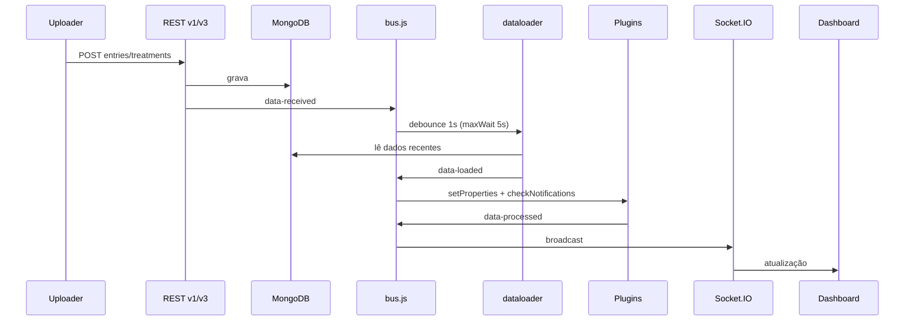
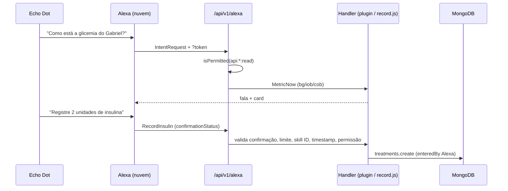

# Mapa de Arquitetura — Nightscout (cgm-remote-monitor)

| Campo | Valor |
|---|---|
| Data de criação | 2026-10-21 |
| Última atualização | 2026-10-21 (v15.0.8, pós-pull do upstream e Alexa clássica) |
| Autor | Mary (Business Analyst, BMad) para Leandro |
| Status | Rascunho — mapa descritivo (não são decisões de arquitetura) |
| Origem | Análise técnica do repositório; complementa [docs/meta/architecture-overview.md](../../docs/meta/architecture-overview.md) |
| Documento relacionado | [PRD de contexto inicial](../prd-contexto-inicial/prd-contexto-inicial.md) |

---

## 1. Linguagens e tecnologias

### 1.1 Distribuição de arquivos (excluindo `node_modules`, `.git`, `_bmad`, `.agents`, `.github`)

| Extensão | Arquivos | Papel |
|---|---|---|
| `.js` | 432 | Servidor, cliente, plugins, testes, scripts |
| `.json` | 86 | Config, traduções, swagger, constantes, fixtures |
| `.png` / `.jpg` / `.svg` / `.gif` | ~84 | Imagens e ícones |
| `.md` | 58 | Documentação |
| `.css` | 26 | Estilos do dashboard |
| `.html` / `.ejs` | ~14 | Templates de views |
| `.sh` | 10 | Scripts de operação/deploy |
| `.yml` / `.yaml` | 7 | CI, docker-compose, swagger |

### 1.2 Linguagem principal

**JavaScript (Node.js, CommonJS, `'use strict'`)** é a única linguagem de programação do produto. Não há TypeScript, Java, Python ou outra linguagem na base (scripts auxiliares em Shell/Bash).

| Medida | Valor |
|---|---|
| Arquivos JS em `lib/` | ~212 (~33,7 mil linhas, inclui tabela de tradução embutida em `language.js`) |
| Arquivos em `tests/` | ~219 (~33,7 mil linhas) |
| Runtime | Node >= 20 (`engines`); imagem Docker `node:22-alpine` |

### 1.3 Stack

| Camada | Tecnologia | Versão (package.json) |
|---|---|---|
| Servidor HTTP | Express | 4.22.1 |
| Tempo real | Socket.IO | ~4.8.3 |
| Banco | MongoDB (driver `mongodb`) | ^5.9.2 |
| Autenticação | `jsonwebtoken`, `shiro-trie` | ^9.0.0, ^0.4.9 |
| Segurança HTTP | `helmet` | ^4.0.0 |
| Sanitização | `sanitize-html` (fixado), `jsdom` | 2.17.5, ^24.1.3 |
| Templates | EJS | ^3.1.8 |
| Cliente | jQuery, D3 v5, Flot, moment | ^3.5.1, ^5.16.0, ^0.8.3, ^2.27.0 |
| Build do cliente | Webpack 5 + Babel | ^5.74.0 |
| IA/agentes (local, não versionado) | `@modelcontextprotocol/sdk`, `zod` | ^1.30.0, ^3.25.76 |
| Testes | Mocha, should, supertest, nyc | ^11.7.5, ^13.2.3, ^3.4.2, ^14.1.1 |
| Lint | ESLint + plugin security | ^7.19.0 |
| CI | GitHub Actions (`main.yml`, `codeql-analysis.yml`, `close-accidental-sync-prs.yml`) | — |

---

## 2. Estrutura de pastas

```text
cgm-remote-monitor/
├── lib/                    # Código da aplicação (~212 .js)
│   ├── server/             # Entrada, boot, Express, WebSocket, Pebble, collections, purifier
│   ├── api/                # REST v1 (inclui alexa/ com record.js)
│   ├── api2/               # REST v2 (properties, summary, notifications)
│   ├── api3/               # REST v3 genérica por collection + sockets /storage e /alarm
│   ├── authorization/      # Roles, subjects, permissões, delay de tentativas
│   ├── plugins/            # 39 plugins (alarmes, pills, integrações, bridges)
│   ├── client/             # Módulos do dashboard (chart, renderer, careportal)
│   ├── client-core/        # Lógica pura extraída do cliente (careportal, devicestatus, profile-editor)
│   ├── data/               # dataloader, ddata, cálculo de delta
│   ├── storage/            # mongo-storage
│   ├── middleware/         # Extensões Express
│   ├── utils/              # Utilitários (substituem lodash)
│   ├── report/ + report_plugins/   # Relatórios históricos
│   ├── admin_plugins/      # Ferramentas de admin
│   ├── mcp/                # Servidor MCP (local, não versionado, fora de escopo)
│   ├── profile/, food/     # Editores
│   └── bus.js, notifications.js, sandbox.js, settings.js, levels.js, language.js ...
├── bundle/                 # Entradas do Webpack (client, reports, clocks)
├── webpack/                # Configuração de build
├── static/                 # CSS, JS legado, imagens, áudio, fontes, Swagger UI
├── views/                  # EJS/HTML: index, admin, food, profile, report, clockviews
├── translations/           # 33 arquivos de idioma
├── tests/                  # ~219 arquivos Mocha (unit + integração + stress + client-core + fixtures)
├── scripts/                # Runner de testes flaky e harnesses
├── bin/                    # Scripts utilitários (post-sgv, deploy, setup)
├── docs/                   # audits, requirements, test-specs, proposals, data-schemas
├── .github/workflows/      # CI e CodeQL
└── Dockerfile, docker-compose.yml, fly.toml, Procfile, app.json, azuredeploy.json, Vagrantfile
```

Pastas de tooling (`_bmad/`, `_bmad-output/`, `.agents/`) pertencem ao BMad, não ao produto.

---

## 3. Visão de contexto (C4 nível 1)



---

## 4. Visão de componentes



Pontos-chave (verificados em código):

- `ctx` é o contêiner de dependências global montado em `bootevent.js` (store, bus, plugins, entries, treatments, authorization, etc.), passado a quase todos os módulos.
- `app.js` monta `/api`, `/api/v1`, `/api/v2`, `/api/v3`, `/pebble`, `/clock`, `/swagger.json`, páginas EJS e arquivos estáticos (cache de 7 dias, 1 s em `development`).
- Se houver `bootErrors`, `app.js` serve apenas a tela de erro de boot.

---

## 5. Sequência de boot



Nota: erros em qualquer etapa são acumulados em `ctx.bootErrors`; etapas seguintes são ignoradas e a aplicação sobe em modo "erro de boot".

---

## 6. Fluxo de dados em tempo real



O evento `tick` (heartbeat) também dispara o recarregamento periódico.

---

## 7. Superfície de APIs

| Interface | Caminho | Observação |
|---|---|---|
| REST v1 | `/api/v1` | Legada, compatibilidade com uploaders; auth por `API_SECRET`/token |
| REST v2 | `/api/v2` | `properties`, `summary`, notificações |
| REST v3 | `/api/v3` | CRUD genérico por collection, `history/{lastModified}`, OpenAPI |
| Socket.IO | `/` (legado), `/storage`, `/alarm` | Dados e alarmes em tempo real |
| Pebble | `/pebble` | Relógio |
| Clock | `/clock` | Telas de relógio |
| Docs | `/swagger.json`, `static/api-docs.html` | Swagger UI |
| MCP | habilitado pelo plugin `mcp` (local, não versionado) | 6 ferramentas somente leitura; fora de escopo |
| Alexa | `POST /api/v1/alexa` | Habilitado por `ENABLE=alexa`; leitura exige `api:*:read`; registro exige `api:treatments:create` |

Collections no MongoDB: `entries`, `treatments`, `devicestatus`, `profile`, `food`, `activity` (índices criados em `ensureIndexes`).

## 7.1 Fluxo de voz (Alexa clássica)



Pontos-chave:

- Leitura passa por `ctx.alexa.getIntentHandler` com a métrica resolvida pelo slot `metric`; a escrita é tratada antes, em `lib/api/alexa/record.js`.
- Configuração via variáveis `ALEXA_RECORD_ENABLED`, `ALEXA_MAX_INSULIN`, `ALEXA_MAX_CARBS` e `ALEXA_SKILL_ID` (extended settings do plugin).
- Idioma das respostas vem da variável `LANGUAGE` do servidor (`br` = pt_BR); o `locale` da requisição não recarrega as traduções.
- Lacuna: a assinatura das requisições da Alexa não é verificada (mitigação: skill ID, janela de 150 s, anti-replay).

---

## 8. Implantação

| Alvo | Artefato |
|---|---|
| Container | [Dockerfile](../../Dockerfile) (`node:22-alpine`, porta 1337, usuário `node`) |
| Orquestração local | [docker-compose.yml](../../docker-compose.yml) |
| PaaS | [fly.toml](../../fly.toml), [Procfile](../../Procfile), [app.json](../../app.json) (Heroku) |
| Azure | [azuredeploy.json](../../azuredeploy.json), [web.config](../../web.config) |
| VM | [Vagrantfile](../../Vagrantfile) |

O `postinstall` executa o bundle Webpack e gera a string aleatória de cache.

---

## 9. Comandos úteis

| Objetivo | Comando |
|---|---|
| Iniciar | `npm start` |
| Desenvolvimento | `npm run dev` (nodemon, requer `my.env`) |
| Bundle do cliente | `npm run bundle` |
| Testes unitários | `npm run test:unit` |
| Testes de integração | `npm run test:integration` (requer MongoDB) |
| Todos (CI) | `npm run test:all:ci` |
| Flaky | `npm run test:flaky` |
| Lint | `npm run lint` |

---

## 10. Observações arquiteturais (para o arquiteto validar)

| # | Observação | Evidência |
|---|---|---|
| O-01 | Acoplamento forte via `ctx` global; difícil testar módulos isoladamente | `bootevent.js` |
| O-02 | Três gerações de API coexistem (v1, v2, v3) com modelos de auth distintos | `lib/api*`, [docs/audits/api-layer-audit.md](../../docs/audits/api-layer-audit.md) |
| O-03 | Duas implementações de tempo real: Socket.IO legado (`websocket.js`) e namespaces v3 | `lib/server/websocket.js`, `lib/api3/*Socket.js` |
| O-04 | Armazenamento acoplado ao MongoDB (comentário `TODO` em `setupStorage`) | `bootevent.js` |
| O-05 | `docs/meta/architecture-overview.md` desatualizado (v15.0.4, mongodb ^3.6, Node 14-20; código está em v15.0.8) | comparação com `package.json` |
| O-06 | Dependências de build em `dependencies`; `event-stream` fixado em 3.3.4 (auditar). `jsdom`, `express` e `request` já foram tratados no upstream | `package.json` |
| O-07 | Bundle do cliente gerado no `postinstall`, acoplando instalação e build | `package.json` |
| O-08 | Sanitização em camadas: `purifier` (sanitize-html) e `storage-purifier` aplicado em `treatments.create`, que também valida `identifier`/`eventType` como string | `lib/server/purifier.js`, `lib/server/treatments.js` |
| O-09 | Migração em curso de lodash para JS nativo e extração de lógica pura para `lib/client-core`; refatorações do upstream podem afetar o fork (ex.: `env` removido de `lib/api/alexa/index.js`) | commits do upstream, `lib/client-core` |
| O-10 | Endpoint Alexa autenticado por token na URL e sem verificação de assinatura; proxy Lambda é a evolução recomendada se o risco for relevante | `lib/api/alexa/` |

---

*Disclaimer BIA Tech: este documento foi gerado com apoio de IA a partir de análise estática do repositório. O conteúdo deve ser validado pelo profissional responsável antes de ser usado em decisões de produto.*
