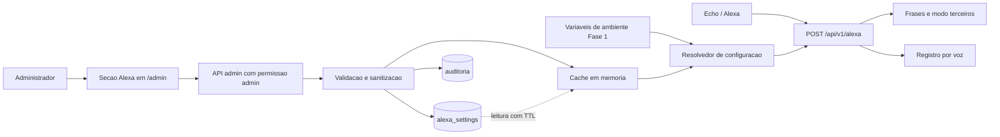

# Requisitos — Fase 2: Painel ADM — Configurações da Alexa

| Campo | Valor |
|---|---|
| Data de criação | 2026-10-22 |
| Autor / PO responsável | Sofia (Product Owner, redação assistida por IA); validação humana pendente |
| Status | Rascunho para validação |
| Origem | Demanda direta do usuário (2026-10-22) + análise técnica do código (`lib/api/alexa/index.js`, `lib/api/alexa/record.js`, `lib/plugins/virtAsstBase.js`, `lib/admin_plugins/`, `lib/authorization/endpoints.js`) |
| Ticket | [epic-painel-adm-alexa.md](epic-painel-adm-alexa.md) |
| Projeto | Nightscout v15.0.8 (fork), hospedado no Fly.io |

> Este documento foi gerado com apoio de IA (BIA Tech) e deve ser validado pelo profissional responsável antes de uso em decisões de produto.

---

## 1. Contexto e problema

O fork possui a skill Alexa clássica em pt-BR (leitura de glicemia, IOB, COB e basal; registro de insulina e carboidratos por voz) no endpoint `POST /api/v1/alexa`. A **Fase 1** (entregue) configura a skill por variáveis de ambiente do plugin `alexa` (`env.extendedSettings.alexa`):

| Variável | Efeito | Padrão |
|---|---|---|
| `ALEXA_RECORD_ENABLED` | Habilita o registro por voz | desabilitado |
| `ALEXA_MAX_INSULIN` | Limite por registro de insulina (U) | 10 |
| `ALEXA_MAX_CARBS` | Limite por registro de carboidratos (g) | 150 |
| `ALEXA_SKILL_ID` | Só aceita requisições do `applicationId` informado | vazio (sem verificação) |
| `ALEXA_PATIENT_NAME` | Ativa o modo "terceiros" (frases em 3ª pessoa) | vazio |
| `ALEXA_PATIENT_PREPOSITION` | `do`/`da`/`de` | `de` (pt-BR) |

Comportamento atual das frases no modo terceiros:

- "A glicemia do Gabriel está em 120, estável." (leitura com até 5 minutos).
- "A glicemia do Gabriel há 5 minutos era de 120, estável. e possui 3 unidades de insulina ativa." (resumo, sem a basal). Leituras com mais de 5 minutos usam "há N minutos era de".

**Problema.** O Nightscout não tem tela de configurações persistentes. O painel `/admin` (`cleanentriesdb`, `cleanprofiledb`, `cleanstatusdb`, `cleantreatmentsdb`, `daterangedelete`, `futureitems`, `roles`, `subjects`) só limpa dados e gerencia roles/subjects. Qualquer ajuste da Alexa exige editar `fly.toml`/secrets no Fly e reiniciar a aplicação. Isso depende de acesso técnico à infraestrutura, causa indisponibilidade breve da skill e dificulta o uso por pai/mãe/responsável.

Fato técnico que favorece a solução: os handlers já leem a configuração **a cada requisição** (`patientSubject()`, `settings()` em `record.js`), portanto trocar a fonte desses valores por um resolvedor com cache não exige redesenhar os handlers.

## 2. Objetivos e não-objetivos

**Objetivos**

1. Permitir que o administrador configure a Alexa em uma seção do `/admin`, sem editar variáveis e sem reiniciar.
2. Cobrir: nome e preposição (modo terceiros), habilitar/desabilitar registro por voz, limites de insulina e carboidratos, skill ID e (a avaliar) limite de idade "está em"/"há N minutos".
3. Mostrar prévia das frases geradas antes de salvar.
4. Manter segurança igual ou superior à da Fase 1 e retrocompatibilidade total.

**Não-objetivos**

- Alterar o fluxo de confirmação, a janela de 150 s ou a deduplicação de `requestId` do registro por voz.
- Implementar verificação de assinatura das requisições Alexa (limitação conhecida, tratada fora desta fase).
- Múltiplos pacientes/perfis, Google Home e Alexa+/MCP (registrados como decisões pendentes; ver seção 14).
- Editar frases/traduções pelo painel (apenas nome, preposição e parâmetros).
- Substituir o mecanismo de roles/subjects.
- Alterar código-fonte nesta etapa de requisitos (documento apenas).

## 3. Personas

| Persona | Descrição | Necessidade |
|---|---|---|
| Administrador (pai/mãe/responsável) | Gerencia o Nightscout; tem token de subject com permissão admin; pouca familiaridade com Fly/variáveis | Ajustar nome, limites e registro por voz em poucos cliques, com confirmação visual do efeito |
| Usuário da Alexa | Quem fala com a Echo (a pessoa acompanhada ou o responsável) | Ouvir frases naturais e corretas; registro seguro; nenhuma indisponibilidade |
| Operador técnico (opcional) | Mantém o deploy no Fly | Manter variáveis de ambiente como padrão/fallback; saber de onde vem cada valor |

## 4. Requisitos funcionais

Ids estáveis (nunca reutilizados). Prioridade: M = Must, S = Should, C = Could.

| Id | Requisito | Prioridade | Prova |
|---|---|---|---|
| R1 | Administrador define nome (≤ 40) e preposição (`do`/`da`/`de`); próxima requisição fala em 3ª pessoa, sem reinício | M | Frase "A glicemia do `<nome>` está em …" na requisição seguinte ao salvar |
| R2 | Administrador habilita/desabilita o registro por voz | M | `RecordInsulin`/`RecordCarbs` registram ou respondem "desabilitado" conforme o valor salvo |
| R3 | Administrador define limites máximos de insulina e carboidratos | M | Pedido acima do limite salvo é recusado; abaixo, registrado |
| R4 | Administrador define o skill ID; leitura nunca devolve o valor em claro | M | Resposta da API traz só "definido/não definido" + máscara; `applicationId` diferente é rejeitado |
| R5 | (a avaliar) Administrador define o limite de idade (min) entre "está em" e "há N minutos era de"; padrão 10 | C | Leitura com idade acima do limite salvo usa a frase com idade |
| R6 | Configuração persistida em coleção MongoDB própria | M | Valores permanecem após reinício/novo deploy |
| R7 | Precedência definida e visível; painel mostra a origem de cada valor e permite "voltar ao ambiente" | M | Origem exibida por campo; remoção devolve o valor da variável |
| R8 | Mudanças valem sem reiniciar (cache invalidado na gravação, TTL máximo para outras instâncias) | M | Efeito na requisição seguinte (mesma instância) e em até o TTL (demais) |
| R9 | Ler/alterar exige permissão de administrador | M | Token sem permissão recebe recusa e nada é alterado |
| R10 | Auditoria de toda alteração | M | Registro com quem, quando, campo, valor anterior e novo |
| R11 | Validação e sanitização no servidor | M | Entradas inválidas rejeitadas (400) sem gravar |
| R12 | Segredos não expostos (skill ID em respostas, logs e auditoria) | M | Busca pelo valor em respostas/logs de teste não o encontra |
| R13 | i18n pt-BR e en | M | Toda chave nova existe nos dois idiomas |
| R14 | Retrocompatibilidade com a Fase 1 | M | Sem valores no painel, comportamento idêntico ao das variáveis; testes existentes passam |
| R15 | Prévia das frases geradas, sem efeitos colaterais | S | Prévia muda ao editar o formulário; nada é gravado nem registrado como tratamento |
| R16 | Falha do Mongo/cache não derruba a skill nem libera o registro (fail-safe) | M | Com Mongo indisponível, a skill responde com os valores do ambiente |
| R17 | Edições concorrentes não se sobrescrevem silenciosamente | S | Gravação com revisão desatualizada retorna 409 |
| R18 | Documentação atualizada (painel, precedência, permissões, verificação em produção) | M | Documento publicado em `docs/plugins` |

### Regras de validação (R11)

| Campo | Regra |
|---|---|
| Nome | Trim; 1–40 caracteres; apenas letras (com acentos), espaços, hífen e apóstrofo; sem HTML nem caracteres de controle; vazio desativa o modo terceiros |
| Preposição | Lista fechada: `do`, `da`, `de`; vazia usa o padrão do idioma (`de` em pt-BR) |
| Limite de insulina / carboidratos | Número finito, > 0, ≤ teto de segurança (premissa: 25 U / 500 g, não editável pelo painel) |
| Skill ID | Formato `amzn1.ask.skill.<uuid>`; valor em claro nunca retornado |
| Limite de idade (R5) | Inteiro de 1 a 60 minutos (premissa) |

## 5. Requisitos não funcionais

| Id | Requisito | Métrica |
|---|---|---|
| NFR1 | Desempenho dos handlers | Sobrecarga do resolvedor com cache ≤ 5 ms por requisição Alexa; nenhuma consulta ao Mongo por requisição quando o cache está válido |
| NFR2 | Propagação | Mesma instância: na requisição seguinte; demais instâncias: ≤ TTL (padrão 30 s) |
| NFR3 | Disponibilidade | 0 reinícios para alterar qualquer parâmetro desta fase |
| NFR4 | Segurança | 100% das rotas do painel exigem permissão admin; 0 ocorrências do skill ID em claro em respostas, logs e auditoria; entrada sempre validada no servidor |
| NFR5 | Resiliência | Falha de leitura do Mongo: resposta da skill em ≤ 3 s com valores em cache ou do ambiente |
| NFR6 | Compatibilidade | Suíte existente (`api.alexa`, `virtasstbase`, `iob`, `cob`, `basalprofileplugin`, `language`, `utils`) passa sem alterar expectativas |
| NFR7 | Qualidade | Código novo com cobertura ≥ 90% (premissa; alinhar ao padrão do projeto); lint (`eslint`) sem erros |
| NFR8 | i18n/Acessibilidade | Campos com rótulo e mensagem de erro textual em pt-BR e en; operável por teclado |
| NFR9 | Auditoria | Retenção mínima de 12 meses (premissa) e consulta por data |

## 6. Decisões de desenho recomendadas (a confirmar)

**Persistência.** Recomendado: coleção MongoDB própria (`alexa_settings`, documento único com `revision`, `updatedAt`, `updatedBy`). Alternativas: (b) coleção genérica de settings, mais reutilizável mas exige criar o conceito; (c) secrets/arquivo no Fly, que mantém o problema de reinício.

**Precedência.** Recomendado: **painel > variável de ambiente > padrão do código**. O painel exibe a origem de cada valor e permite "remover valor do painel". Alternativas: (b) ambiente > painel — o ambiente "trava" o campo e o painel vira somente leitura nele; mais seguro para o operador, pior para o administrador; (c) híbrida por campo com bloqueio explícito (`ALEXA_LOCK_*`), mais flexível e mais complexa.

**Cache/recarga.** Resolvedor único que consulta o cache em memória; a gravação o invalida na própria instância; TTL máximo (30 s) cobre outras instâncias. Falha de leitura usa o último valor válido e, na ausência, o ambiente (fail-safe).

**Fronteira de código.** Handlers (`index.js`, `record.js`, `virtAsstBase.js`) passam a consumir o resolvedor em vez de `env.extendedSettings.alexa`, mantendo as assinaturas atuais.

## 7. Fluxo (visão geral)



## 8. Riscos e mitigações

| # | Risco | Categoria | Prob. | Impacto | Mitigação |
|---|---|---|---|---|---|
| 1 | Aumento indevido de limites ou habilitação do registro por alguém sem permissão | Segurança | Baixa | Alto (dose registrada) | Permissão admin dedicada; teto rígido fora do painel; auditoria; padrão desabilitado |
| 2 | Vazamento do skill ID em API/logs/auditoria | Segurança | Média | Médio | Leitura mascarada; sanitização de logs; teste que busca o valor |
| 3 | Injeção/HTML no nome exibido ou falado | Segurança | Média | Médio | Validação por lista de caracteres; sanitização no servidor e escape na tela |
| 4 | Inconsistência entre instâncias/cache | Concorrência | Média | Médio | TTL máximo; invalidação na gravação; `revision` com 409 |
| 5 | Edição simultânea por dois administradores | Concorrência | Baixa | Baixo | Controle otimista (R17) |
| 6 | Indisponibilidade do Mongo derrubar a skill ou liberar registro | Resiliência | Baixa | Alto | Fail-safe: último valor válido, senão ambiente; registro nunca habilitado por falha |
| 7 | Divergência entre painel e ambiente confunde o operador | Migração | Média | Médio | Origem visível por campo; "voltar ao ambiente"; documentação |
| 8 | Regressão da Fase 1 | Migração | Média | Alto | R14/NFR6; suíte existente como portão; sem registro no painel = comportamento igual |
| 9 | Aumento de escopo (idiomas, múltiplos pacientes, Google Home) | Escopo | Alta | Médio | Não-objetivos explícitos; decisões pendentes registradas; R5 como "Could" |
| 10 | Prévia divergir da frase real | Qualidade | Média | Baixo | Prévia usa as mesmas rotinas/traduções dos handlers; teste comparando prévia e resposta |

## 9. Dependências

- Mongo já disponível (`ctx.store`) e padrão de coleções existente.
- Autorização por roles/subjects (shiro); definição das permissões `admin:api:alexa:read` e `admin:api:alexa:update` (propostas) e inclusão na role admin.
- Painel `/admin` (`lib/admin_plugins`) e arquivos de tradução existentes (pt-BR/en).
- Fase 1 entregue e testes existentes como linha de base.
- Acesso ao Fly.io para verificação final em produção (história hitl).
- Confirmação clínica dos tetos de segurança (premissa).

## 10. Métricas de sucesso

| Métrica | Meta |
|---|---|
| Reinícios necessários para alterar parâmetros da Alexa | 0 |
| Tempo para o admin alterar nome/limite e ouvir o efeito | ≤ 2 minutos, sem acesso ao Fly |
| Alterações auditadas | 100% |
| Exposições do skill ID em claro (respostas, logs, auditoria) | 0 |
| Regressões na suíte existente | 0 testes alterados/quebrados |
| Propagação da mudança | ≤ 1 requisição (mesma instância); ≤ 30 s (demais) |
| Chaves de tradução novas sem pt-BR e en | 0 |

## 11. Critérios de aceite do epic (Gherkin)

```gherkin
Cenário: Alterar o nome do acompanhado sem reiniciar
  Dado que o administrador autenticado abre a seção Alexa do painel /admin
  E o modo terceiros está desativado
  Quando salva o nome "Gabriel" com a preposição "do"
  Então a requisição seguinte de leitura da Alexa responde "A glicemia do Gabriel está em 120, estável."
  E nenhuma reinicialização da aplicação ocorreu

Cenário: Limite de insulina vindo do painel
  Dado que o registro por voz está habilitado e o limite de insulina salvo é 5
  Quando a Alexa envia um pedido confirmado de 6 unidades
  Então a resposta informa que o valor excede o limite
  E nenhum tratamento é criado

Cenário: Usuário sem permissão administrativa
  Dado um token sem a permissão admin de alteração da Alexa
  Quando tenta salvar qualquer campo da configuração
  Então a API responde 401 ou 403
  E a configuração e a auditoria permanecem inalteradas

Cenário: Segredo não exposto
  Dado que um skill ID está salvo
  Quando um administrador lê a configuração
  Então a resposta indica apenas "definido" e uma máscara
  E o valor completo não aparece em respostas, logs nem auditoria

Cenário: Retrocompatibilidade com a Fase 1
  Dado que nenhum valor foi salvo no painel e ALEXA_PATIENT_NAME=Gabriel está no ambiente
  Quando a Alexa consulta a glicemia
  Então a frase é a mesma da Fase 1
  E a suíte de testes existente passa sem alterações
```

## 12. Fatiamento em epic e histórias

**Epic:** `epic-painel-adm-alexa` — "O administrador configura a Alexa no painel /admin, sem reinício". Regras do fatiamento: uma ponta a ponta fina primeiro (traçador), depois ampliação por campo/camada; cada história cabe em uma sessão de agente; testes dentro de cada história; epic com mais de três histórias fecha com varredura de refatoração.

Estimativa relativa **proposta** (P/M/G; não é prazo e não substitui estimativa do time):

| Id | História | Cobre | Depende de | Est. | Risco |
|---|---|---|---|---|---|
| 1 | Persistir e aplicar nome e preposição via API administrativa (traçador) | R1, R6, R8, R9, R11, R14, R16, R17 | — | M | médio |
| 2 | Seção Alexa no `/admin` com nome e preposição | R1, R13 | 1 | M | baixo |
| 3 | Habilitar registro, limites, skill ID e precedência no backend | R2, R3, R4, R7, R12 | 1 | M | alto |
| 4 | Tela dos demais campos, origem do valor e skill ID mascarado | R2, R3, R4, R7, R13 | 2, 3 | M | médio |
| 5 | Auditoria de alterações | R10, R12 | 3 | P | médio |
| 6 | Prévia das frases geradas | R15 | 2 | M | baixo |
| 7 | Limite de idade configurável (a avaliar) | R5 | 3 | P | baixo |
| 8 | Documentação e verificação em produção (Fly) | R18 | 4, 5, 6 | P | baixo |
| 9 | Varredura de refatoração (fecha o epic) | — | 1–8 | P | baixo |

Ordem de construção = ordem da tabela. Paralelismo possível: 2 e 3 após a 1; 5, 6 e 7 após suas dependências. Adiado/fora: múltiplos pacientes, Google Home, edição de frases.

### História 1 — Persistir e aplicar nome e preposição via API (traçador)

Como administrador, quero salvar nome e preposição por uma API administrativa, para que a Alexa passe a falar em 3ª pessoa sem eu reiniciar nada.

```gherkin
Cenário: Salvar e aplicar
  Dado um token com permissão admin de alteração da Alexa e nenhum valor salvo
  Quando envia PUT com nome "Gabriel" e preposição "do"
  Então a API responde 200 com a nova revisão
  E a requisição Alexa seguinte usa "do Gabriel" sem reinício

Cenário: Entrada inválida
  Dado um token com permissão admin
  Quando envia nome com 41 caracteres, com "<script>" ou preposição "para"
  Então a API responde 400 com a mensagem do campo inválido
  E nada é gravado

Cenário: Revisão desatualizada
  Dado que a revisão atual é 3
  Quando um PUT chega com revisão 2
  Então a API responde 409 e a configuração não muda

Cenário: Mongo indisponível
  Dado que há valor em cache ou variáveis de ambiente definidas
  Quando a leitura no Mongo falha
  Então a Alexa responde com o valor em cache ou do ambiente e registra o erro sem expor detalhes
```

### História 2 — Seção Alexa no /admin (nome e preposição)

Como administrador, quero preencher nome e preposição numa tela do painel, para configurar a Alexa sem usar a API.

```gherkin
Cenário: Seção visível apenas para administrador
  Dado um usuário com permissão admin
  Quando abre /admin
  Então vê a seção "Alexa" com campos nome e preposição preenchidos com os valores atuais

Cenário: Salvar com sucesso
  Dado nome "Gabriel" e preposição "do" válidos
  Quando clica em Salvar
  Então a tela exibe confirmação textual e a revisão atual

Cenário: Erro de validação e idioma
  Dado nome com mais de 40 caracteres e o idioma en selecionado
  Quando clica em Salvar
  Então a tela exibe o erro em inglês junto ao campo e não grava
```

### História 3 — Registro, limites, skill ID e precedência (backend)

Como administrador, quero habilitar o registro por voz e definir limites e skill ID, para controlar o que a Alexa pode registrar.

```gherkin
Cenário: Precedência
  Dado ALEXA_MAX_INSULIN=10 no ambiente e limite 5 salvo no painel
  Quando a Alexa recebe pedido confirmado de 6 unidades
  Então é recusado por exceder 5
  E, ao remover o valor do painel, o limite volta a 10

Cenário: Skill ID protegido
  Dado um skill ID salvo
  Quando a configuração é lida pela API
  Então a resposta traz "definido" e máscara, nunca o valor completo
  E requisições com outro applicationId continuam rejeitadas

Cenário: Falha segura do registro
  Dado que o registro está desabilitado no ambiente e a leitura do Mongo falha
  Quando chega um pedido de registro
  Então a Alexa responde que o registro está desabilitado e nenhum tratamento é criado

Cenário: Limite acima do teto
  Dado teto de segurança de 25 U
  Quando o administrador tenta salvar limite de insulina 30
  Então a API responde 400 e não grava
```

### História 4 — Tela dos demais campos e origem do valor

Como administrador, quero ver e editar os demais parâmetros e saber de onde vem cada valor, para evitar surpresas entre painel e ambiente.

```gherkin
Cenário: Origem exibida
  Dado limite de carboidratos vindo do ambiente e nenhum valor no painel
  Quando abre a seção Alexa
  Então o campo mostra o valor e a origem "ambiente"

Cenário: Voltar ao ambiente
  Dado limite salvo no painel
  Quando clica em "Remover valor do painel" e confirma
  Então o campo volta a mostrar o valor do ambiente com origem "ambiente"

Cenário: Skill ID mascarado
  Dado um skill ID salvo
  Quando a tela é carregada
  Então o campo mostra "definido" com máscara e só envia novo valor se o administrador digitar um
```

### História 5 — Auditoria de alterações

Como administrador, quero um histórico de quem mudou o quê e quando, para rastrear mudanças de risco (limites e registro por voz).

```gherkin
Cenário: Alteração auditada
  Dado que o limite de insulina muda de 10 para 5
  Quando a gravação conclui
  Então existe um registro com usuário, data/hora, campo, valor anterior 10 e novo 5

Cenário: Skill ID sem valor em claro
  Dado que o skill ID é alterado
  Quando consulta a auditoria
  Então o registro indica "alterado" sem os valores anterior e novo

Cenário: Gravação recusada não audita como alteração
  Dado uma entrada inválida rejeitada com 400
  Quando consulta a auditoria
  Então nenhum registro de alteração foi criado para ela
```

### História 6 — Prévia das frases geradas

Como administrador, quero ouvir/ler exemplos das frases antes de salvar, para confirmar nome e preposição.

```gherkin
Cenário: Prévia dinâmica
  Dado nome "Gabriel" e preposição "do" digitados e não salvos
  Quando a prévia é atualizada
  Então exibe "A glicemia do Gabriel está em 120, estável." e o resumo sem a basal

Cenário: Sem efeitos colaterais
  Dado que a prévia foi gerada várias vezes
  Quando consulta tratamentos e a configuração salva
  Então nenhum tratamento foi criado e a configuração permanece igual

Cenário: Paridade com a resposta real
  Dado a mesma configuração salva
  Quando a Alexa responde a uma leitura e a prévia é gerada
  Então o texto da prévia usa as mesmas frases e traduções da resposta real
```

### História 7 — Limite de idade configurável (a avaliar)

Como administrador, quero definir a partir de quantos minutos a Alexa diz "há N minutos era de", para ajustar à frequência de leitura do sensor.

```gherkin
Cenário: Limite maior
  Dado limite de 15 minutos salvo e leitura com 12 minutos
  Quando a Alexa informa a glicemia
  Então usa "está em"

Cenário: Limite menor
  Dado limite de 5 minutos e leitura com 8 minutos
  Quando a Alexa informa a glicemia
  Então usa "há 8 minutos era de"

Cenário: Valor inválido ou ausente
  Dado limite 0 ou 90, ou nenhum valor salvo
  Quando a gravação é tentada ou a Alexa responde
  Então 0 e 90 são rejeitados (400) e a ausência mantém o padrão de 5 minutos
```

### História 8 — Documentação e verificação em produção

Como operador, quero a documentação do painel e um roteiro de verificação no Fly, para operar e dar suporte sem depender de quem implementou.

```gherkin
Cenário: Documento completo
  Dado o documento em docs/plugins para a Alexa
  Quando um operador novo o lê
  Então encontra variáveis, precedência, permissões, campos do painel e exemplos de frases

Cenário: Verificação em produção
  Dado o deploy no Fly concluído
  Quando uma pessoa executa o roteiro (alterar nome, limite e registro, e testar na Echo)
  Então os resultados esperados são confirmados e anexados ao ticket

Cenário: Retorno ao ambiente
  Dado valores salvos no painel
  Quando o operador segue o passo "voltar ao ambiente"
  Então a skill passa a usar os valores das variáveis
```

### História 9 — Varredura de refatoração

Como time, queremos consolidar o código do epic, para manter o resolvedor simples e testado.

```gherkin
Cenário: Sem leitura direta antiga
  Dado o epic concluído
  Quando se busca por leituras diretas de env.extendedSettings.alexa nos handlers
  Então não restam usos fora do resolvedor

Cenário: Suíte verde
  Dado a refatoração concluída
  Quando a suíte de testes e o lint são executados
  Então passam sem alterar expectativas existentes

Cenário: Escopo apenas de limpeza
  Dado o diff da história
  Quando revisado
  Então não contém comportamento novo
```

## 13. Definition of Ready e Definition of Done

**Definition of Ready (história)**

- Persona, ação e benefício escritos; pelo menos 3 critérios Dado/Quando/Então mensuráveis.
- Requisitos cobertos (ids R) e dependências identificadas.
- Perguntas em aberto que a bloqueiam resolvidas (ver seção 14) ou registradas como `Unknown`.
- Risco classificado; hitl declarado quando uma pessoa executa parte.
- Cabe em uma sessão de agente.

**Definition of Done (história)**

- Critérios de aceite verificados por teste automatizado (ou roteiro, se hitl).
- Testes existentes de Alexa/virtAsst passam sem alterar expectativas; lint sem erros.
- Entradas validadas no servidor; permissão admin exigida; nenhum segredo em claro em respostas e logs.
- Chaves de tradução em pt-BR e en.
- Documentação da história atualizada; revisão de código feita; sem pendências de segurança abertas.

**Definition of Done (epic)**

- Todos os critérios da seção 11 verificados; R14 e NFR6 confirmados.
- Verificação em produção (Fly) anexada; documentação publicada.
- Métricas da seção 10 medidas ou demonstradas.

## 14. Perguntas em aberto e decisões pendentes

| # | Pergunta / decisão | Recomendação | Quem espera |
|---|---|---|---|
| 1 | Onde persistir: coleção própria ou coleção `settings` genérica? | Coleção própria | História 1 |
| 2 | Precedência final entre painel e ambiente (seção 6) | Painel > ambiente > padrão | Histórias 1, 3, 4 |
| 3 | Múltiplos pacientes/perfis no futuro: modelo nasce como lista de perfis ou documento único? | Documento único com campo de versão; migrar quando houver demanda | História 1 |
| 4 | Google Home/outros assistentes: nomear a seção de forma genérica desde já? | Rótulo "Alexa" agora; chave de dados neutra | Histórias 2, 4 |
| 5 | Incluir o limite de idade (R5) nesta fase? Faixa 1–60? | Incluir ao final, como "Could" | História 7 |
| 6 | Tetos de segurança (25 U / 500 g) estão corretos? Quem valida (responsável clínico)? | Confirmar antes da história 3 | Histórias 3, 4 |
| 7 | Skill ID pode ser limpo (desliga a verificação) ou é obrigatório com registro habilitado? | Exigir skill ID para habilitar registro | História 3 |
| 8 | Há mais de uma instância no Fly? Define a relevância do TTL | Assumir uma instância; manter TTL | História 1 |
| 9 | Nome exato das permissões e do endpoint (`admin:api:alexa:*`; `/api/v1/alexa/settings` sem colidir com `POST /api/v1/alexa`) | Validar com arquitetura | História 1 |
| 10 | Retenção e local da auditoria (coleção própria vs. log) | Coleção própria, 12 meses | História 5 |

## 15. Premissas

- O epic fica na iniciativa existente `initiative-nightscout-modernizacao` (objetivo redefinido em 2026-10-21 para manter a Alexa clássica); nenhuma iniciativa ativa estava registrada e nada foi alterado em `config.user.toml`.
- A execução foi sem interação com o usuário; escolhas viraram premissas e dúvidas acima.
- Os handlers continuam lendo configuração por requisição (verificado no código), o que viabiliza R8 sem mudança de contrato.
- Aviso de ambiente: a renderização da skill de PO deixou variáveis de template (`{{ ... }}`) sem resolução; foram usados os padrões de `customize.toml`.

## 16. Rastreabilidade

| Origem | Onde aparece |
|---|---|
| Demanda do usuário (2026-10-22) | Seções 1–5, 12, 14 |
| `lib/api/alexa/index.js` (`patientSubject`, 40/10 caracteres) | R1, R11 |
| `lib/api/alexa/record.js` (`settings`, limites, skill ID, janela 150 s, dedupe) | R2–R4, R16, não-objetivos |
| `lib/plugins/virtAsstBase.js` (`FRESH_MINUTES = 10`) | R5 |
| `lib/admin_plugins/` e `lib/authorization/endpoints.js` | R9, História 2, seção 9 |
| Memlog do epic (`.memlog.md`) | Decisões, premissas e perguntas |
