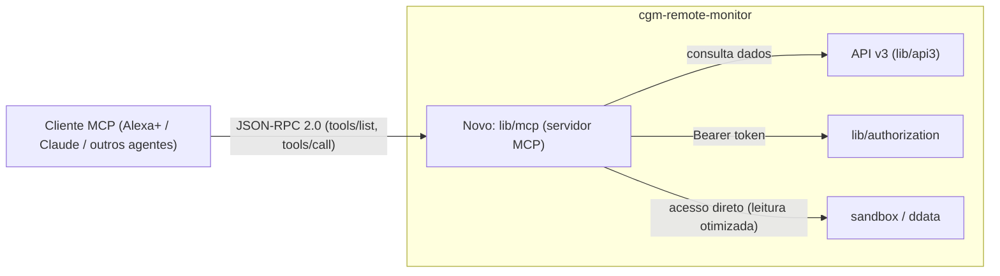

# Análise de Viabilidade: Servidor MCP para Feature Alexa+

**Status:** Proposta / Análise (nenhuma alteração de código foi realizada)
**Data:** 2026-07-31
**Escopo:** Avaliar a viabilidade de criar um servidor MCP (Model Context Protocol) no projeto `nightscout/cgm-remote-monitor` para atender aos padrões exigidos por uma feature da Alexa+.

---

## 1. Resumo Executivo

É **tecnicamente viável** criar um servidor MCP para o Nightscout, reaproveitando a infraestrutura de API já existente (API v1 "classic", API v3 REST/JWT e o skill Alexa clássico baseado em ASK). O projeto já expõe os dados necessários (glicemia, IOB/COB, tratamentos, perfil, status de dispositivos) através de camadas de API maduras e testadas, e possui um modelo de autorização baseado em tokens/JWT com escopo de permissões (Shiro-trie) que se encaixa bem no modelo de autenticação exigido por servidores MCP (Bearer tokens / OAuth2).

O principal ponto de incerteza **não é técnico, e sim de especificação externa**: até o momento não existe documentação pública, oficial e estável da Amazon descrevendo um programa "Alexa+ MCP" com um contrato formal (schema de tools, formato de descoberta, requisitos de certificação). A Alexa+ (anunciada pela Amazon em fevereiro de 2025) é uma reformulação generativa/agentic da Alexa clássica, e a Amazon tem sinalizado publicamente movimento em direção a integrações de terceiros mais abertas e "agentic actions", mas o alinhamento com o padrão aberto MCP (originado pela Anthropic, hoje mantido pela comunidade `modelcontextprotocol.io`) para *skills/features* de terceiros não pôde ser confirmado com uma fonte oficial acessível nesta análise.

**Recomendação:** tratar isso como um projeto em duas fases:
1. Construir um **servidor MCP genérico**, desacoplado da Alexa, expondo os dados/ações do Nightscout como *tools* MCP (compatível com qualquer cliente MCP: Claude, editores, futuros agentes).
2. Adaptar/mapear esse servidor para os requisitos específicos da Alexa+ assim que a Amazon publicar (ou disponibilizar em beta) a especificação formal de integração, sem re-arquitetar a base construída na fase 1.

---

## 2. O que já existe no projeto (estado atual)

### 2.1 Integração Alexa "clássica" (Alexa Skills Kit / ASK)

| Componente | Arquivo | Papel |
|---|---|---|
| Plugin core do Alexa | [lib/plugins/alexa.js](../../lib/plugins/alexa.js) | Registra handlers de *intent*, agrega respostas ("rollup"), monta o `SpeechletResponse` no formato ASK (`outputSpeech`, `card`, `reprompt`). |
| Rota HTTP | [lib/api/alexa/index.js](../../lib/api/alexa/index.js) | Expõe `POST /api/v1/alexa`, roteia `LaunchRequest`/`IntentRequest`/`SessionEndedRequest`. |
| Base compartilhada Alexa/Google Home | [lib/plugins/virtAsstBase.js](../../lib/plugins/virtAsstBase.js) | Intents mútuos (`NSStatus`, `MetricNow`), permite que outros plugins registrem `virtAsst.intentHandlers`/`rollupHandlers`. |
| Ativação condicional | [lib/server/bootevent.js](../../lib/server/bootevent.js) (linhas ~237-241) | Só inicializa `ctx.alexa`/`ctx.virtAsstBase` se o plugin `alexa` (ou `googlehome`) estiver habilitado via `ENABLE`. |
| Documentação de setup | [docs/plugins/alexa-plugin.md](../../docs/plugins/alexa-plugin.md) | Passo a passo para criar a *custom skill* no Alexa Developer Console e apontar para `/api/v1/alexa`. |
| Guia para novos plugins | [docs/plugins/add-virtual-assistant-support-to-plugin.md](../../docs/plugins/add-virtual-assistant-support-to-plugin.md) | Como um plugin adiciona novos *intents*/slots. |
| Testes | [tests/api.alexa.test.js](../../tests/api.alexa.test.js) | Cobertura da rota `/api/v1/alexa`. |

Esse modelo é o **clássico ASK** (perguntas/respostas por *intent* fixo, definido em um "modelo de interação" estático publicado no Alexa Developer Console). Não há hoje nenhuma referência a MCP, JSON-RPC, "tools"/"resources" ou qualquer termo do protocolo MCP em todo o repositório (busca completa não retornou ocorrências).

### 2.2 APIs REST reaproveitáveis como base de dados para o MCP

| API | Local | Autenticação | Observações |
|---|---|---|---|
| API v1 | `lib/api/` | Token simples (`api-secret` / roles) | Usada hoje pelo Alexa clássico. |
| **API v3** | `lib/api3/` | **Bearer JWT** validado por [lib/api3/security.js](../../lib/api3/security.js), com permissões via `shiro-trie` (ex.: `api:*:read`) | Modelo de segurança mais próximo do exigido por clientes MCP modernos (Bearer token, escopos). Endpoints para `entries`, `treatments`, `devicestatus`, `profile`, `food`, `settings` (`app.set('enabledCollections', [...])` em [lib/api3/index.js](../../lib/api3/index.js)). Já documentado via OpenAPI ([lib/api3/swagger.json](../../lib/api3/swagger.json) / `swagger.yaml`). |
| Autorização central | `lib/authorization/` (`index.js`, `endpoints.js`, `storage.js`) | Gera/valida tokens, define *roles* e *permissions* | Reaproveitável para emitir credenciais de acesso ao servidor MCP sem duplicar lógica de auth. |

A existência de um **OpenAPI/Swagger já pronto para a API v3** é um ativo importante: muitas implementações de servidores MCP (ex.: `@modelcontextprotocol/sdk`, ou wrappers como "OpenAPI-to-MCP") conseguem gerar *tool definitions* automaticamente a partir de um schema OpenAPI, o que reduziria bastante o esforço de implementação manual de cada *tool*.

### 2.3 Lacunas identificadas

- Não há servidor JSON-RPC (protocolo base do MCP) em lugar algum do código — precisaria ser adicionado como novo componente (novo diretório, ex. `lib/mcp/`, ou processo separado).
- Não há mecanismo de emissão de tokens padrão OAuth2/OIDC "pronto para uso" (existe [docs/proposals/oidc-actor-identity-proposal.md](../../docs/proposals/oidc-actor-identity-proposal.md), uma proposta ainda não implementada, relevante para autenticação de agentes).
- O modelo de dados/respostas do Alexa clássico é otimizado para *texto falado* (`outputSpeech`), não para *dados estruturados* — um servidor MCP deve retornar dados estruturados (JSON) que o modelo da Alexa+ interpretaria e converteria em fala, então a camada de "tradução para fala" do plugin atual (`buildSpeechletResponse`) não é diretamente reaproveitável, mas a lógica de *busca de dados* (via `virtAsstBase`, `entries.list`, `sandbox`) sim.

---

## 3. O que é a Alexa+ e por que ela é diferente do Alexa Skills clássico

- A Alexa+ foi anunciada pela Amazon (fev/2025) como uma reconstrução da Alexa sobre modelos de linguagem generativos (incluindo modelos da Amazon e parcerias, como a Anthropic), com capacidades *agentic* (executar tarefas em múltiplos passos, não apenas responder a *intents* fixos).
- Publicamente, a Amazon tem comunicado a intenção de abrir a Alexa+ para um ecossistema maior de integrações de terceiros ("actions"/agentes), mas **não foi possível localizar, no momento desta análise, uma especificação técnica pública e estável descrevendo formalmente**:
  - o formato de descoberta/registro de uma "feature"/"action" de terceiros;
  - se o transporte é MCP puro (JSON-RPC 2.0 sobre stdio/HTTP+SSE, conforme `modelcontextprotocol.io`), uma variante proprietária, ou os antigos *Custom Skills*/*Smart Home Skills* do Alexa Skills Kit;
  - requisitos de certificação/segurança específicos da Amazon para esse novo modelo.
- Isso é consistente com o fato de a Alexa+ ainda estar em *rollout* controlado (beta/convites) em partes do mercado, e programas para desenvolvedores desse tipo normalmente amadurecem e são documentados publicamente meses depois do lançamento do produto ao consumidor final.

**Implicação prática:** qualquer implementação feita agora precisa ser guiada por (a) o padrão aberto MCP genérico (que é estável e bem documentado em `modelcontextprotocol.io`) e (b) o que for aprendido de fontes primárias da Amazon (Amazon Developer Console / Build with Alexa+ program) assim que houver acesso. Este documento não deve ser lido como confirmação de que a Amazon exige literalmente "MCP" para a Alexa+ — é uma hipótese de trabalho razoável dada a tendência da indústria (Anthropic, OpenAI, Google e diversas plataformas já adotaram MCP como camada de integração de ferramentas para agentes de IA), mas deve ser validada com a documentação oficial antes da implementação final.

---

## 4. Desenho proposto (caso se decida seguir em frente)

### 4.1 Princípio orientador
Construir o servidor MCP como uma **camada fina sobre a API v3 existente**, não substituindo nada, seguindo o mesmo padrão de "plugin opcional habilitado via `ENABLE`" já usado por `alexa`/`googlehome`.

### 4.2 Componentes propostos

### 4.3 Tools MCP candidatas (mapeadas a partir do que já existe)

| Tool MCP proposta | Baseado em | Tipo |
|---|---|---|
| `get_current_glucose` | `entries.list({count:1})` (mesmo usado por `virtAsstBase.setupMutualIntents`) | leitura |
| `get_glucose_history` | API v3 `GET /entries` | leitura |
| `get_iob_cob` | `sandbox` (`iob`, `cob` plugins) | leitura |
| `get_treatments` | API v3 `GET /treatments` | leitura |
| `get_device_status` (bateria de sensor/bomba, modo de loop) | API v3 `GET /devicestatus` | leitura |
| `get_profile` | API v3 `GET /profile` | leitura |
| `create_treatment` (ex.: registrar refeição/bolus manualmente) | API v3 `POST /treatments` | escrita (requer permissão explícita) |

Cada *tool* de escrita deve exigir escopo de permissão dedicado (reaproveitando `shiro-trie`), consentimento explícito do usuário e, idealmente, confirmação em duas etapas — dado que se trata de dados de saúde (glicemia, insulina).

### 4.4 Autenticação/Autorização
- Reaproveitar o modelo Bearer JWT da API v3 (`lib/api3/security.js`) como mecanismo de auth do servidor MCP.
- Avaliar a proposta já existente em [docs/proposals/oidc-actor-identity-proposal.md](../../docs/proposals/oidc-actor-identity-proposal.md) para identidade de "atores" (ex.: distinguir "Alexa+ agindo em nome do usuário X" de "usuário X diretamente"), o que tende a ser exigido por qualquer plataforma de agentes de terceiros por motivos de auditoria.
- Nunca expor o token de longa duração diretamente ao dispositivo Alexa; preferir um fluxo de concessão (OAuth2 Authorization Code) equivalente ao que já é usado para vincular a *Custom Skill* clássica (Account Linking, mencionado em [docs/plugins/alexa-plugin.md](../../docs/plugins/alexa-plugin.md)).

### 4.5 Considerações de segurança (dados de saúde)
- Dados de glicemia/insulina são dados sensíveis de saúde — qualquer *tool* MCP exposta deve manter o mesmo rigor de autorização por escopo já usado na API v3, e não deve ampliar a superfície de leitura além do que o token permite (`shiro.check(permission)`).
- Rate limiting e logging de auditoria (quem/quando um agente externo leu ou escreveu dados) devem ser adicionados — hoje não há um log de auditoria dedicado para chamadas de agentes de IA.
- Deve ser avaliado se o servidor MCP roda no mesmo processo do Nightscout (menor esforço, maior superfície de risco) ou como processo/serviço separado autenticado via rede (mais isolamento, mais complexidade operacional).

---

## 5. Esforço estimado por etapa (ordem de grandeza, não estimativa de tempo)

1. **Servidor MCP genérico (fase 1)** — esforço baixo/médio: implementar transporte JSON-RPC (bibliotecas MCP SDK oficiais existem para Node.js), 4-6 *tools* de leitura mapeando API v3, testes de integração seguindo o padrão de `tests/api3.*.test.js`.
2. **Escrita/ações (tratamentos)** — esforço médio: exige modelagem de consentimento e confirmação, além de validação de payload já existente em `lib/api3/generic`.
3. **Adequação específica à Alexa+** — esforço **indeterminado** até haver documentação oficial da Amazon; pode variar de "pequenos ajustes de formato" a "reescrita do transporte/certificação", dependendo do que a Amazon exigir.

---

## 6. Riscos e bloqueios

| Risco | Impacto | Mitigação |
|---|---|---|
| Falta de especificação pública oficial da Amazon para integração de terceiros na Alexa+ | Alto — pode invalidar decisões de formato tomadas hoje | Construir a fase 1 (MCP genérico) de forma independente de Alexa+, validando contra o spec aberto `modelcontextprotocol.io`; revisar assim que a Amazon publicar docs/entrar em programa de developer preview |
| Exposição de dados de saúde sensíveis a um novo canal de terceiros (Amazon) | Alto | Escopo de permissão explícito, consentimento, auditoria, revisão de conformidade (ex.: LGPD/HIPAA conforme jurisdição do usuário) |
| Ausência de processo de certificação conhecido para "skills"/"features" Alexa+ | Médio | Acompanhar Amazon Developer Console; não assumir compromissos de prazo até certificação ficar clara |
| Duplicação de lógica entre Alexa clássico (`virtAsstBase`) e novo servidor MCP | Baixo/Médio | Extrair lógica de obtenção de dados (não a de resposta em fala) para um módulo compartilhado reutilizado por ambos |

---

## 7. Conclusão

Do ponto de vista de **infraestrutura interna do Nightscout**, o projeto está bem posicionado para suportar um servidor MCP: já existem API REST versionada com OpenAPI (v3), autenticação Bearer/JWT com escopos, e um precedente arquitetural de integração com assistentes de voz (plugin `alexa`, `virtAsstBase`) que pode servir de referência de organização de código.

Do ponto de vista de **requisitos externos da Alexa+**, a viabilidade não pode ser confirmada com certeza total nesta análise porque não foi localizada documentação oficial, estável e pública da Amazon detalhando o contrato exato exigido para integrar uma feature de terceiros via MCP (ou equivalente) na Alexa+. Recomenda-se seguir com a fase 1 (servidor MCP genérico, aderente ao spec aberto do MCP) como investimento de baixo risco e alto reaproveitamento, e tratar a integração específica com a Alexa+ como uma segunda fase condicionada à confirmação dos requisitos oficiais da Amazon.

---

## 8. Próximos passos sugeridos (aguardando aprovação, nenhum já executado)

1. Confirmar com fonte primária (Amazon Developer Console / "Build with Alexa+" quando disponível) o contrato técnico exigido.
2. Definir se o servidor MCP roda embutido no processo Nightscout ou como serviço companion.
3. Prototipar as *tools* de leitura (`get_current_glucose`, `get_iob_cob`, `get_treatments`) sobre a API v3 existente, em um diretório novo (ex.: `lib/mcp/`), atrás de uma flag `ENABLE=mcp` seguindo o padrão dos demais plugins.
4. Definir modelo de consentimento/escopo para eventuais *tools* de escrita antes de implementá-las.
